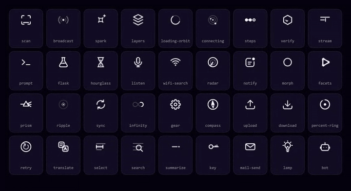

# Ultra Lab Motion Icons

會動的小圖示，純 SVG 與 CSS，零依賴，複製就能用。
Little icons that move. Pure SVG and CSS, zero dependencies, copy and paste.

36 個圖示 ・ 展示櫃 Showcase：https://ultralab.tw/icons ・ 授權 License：MIT



| 類別 Family | 圖示 Icons |
|---|---|
| 訊號 Signal | `scan` 掃描 ・ `broadcast` 發送 ・ `listen` 收音 ・ `wifi-search` 找訊號 ・ `radar` 雷達 ・ `notify` 新通知 |
| 形體 Form | `spark` 靈光 ・ `layers` 疊層 ・ `morph` 變形 ・ `facets` 切面 ・ `prism` 稜鏡 ・ `wave` 波紋 |
| 軌道 Orbit | `loading-orbit` 載入軌道 ・ `connecting` 連線 ・ `sync` 同步 ・ `infinity` 無限 ・ `gear` 齒輪 ・ `compass` 羅盤 |
| 進程 Progress | `steps` 步驟 ・ `verify` 驗證 ・ `upload` 上傳 ・ `download` 下載 ・ `percent-ring` 進度環 ・ `retry` 重試 |
| 書寫 Write | `stream` 串流 ・ `prompt` 提示列 ・ `translate` 翻譯 ・ `select` 選取 ・ `search` 搜尋 ・ `summarize` 摘要 |
| 器物 Object | `flask` 燒瓶 ・ `hourglass` 沙漏 ・ `key` 鑰匙 ・ `mail-send` 寄出 ・ `lamp` 燈泡 ・ `bot` 小助理 |

每個圖示：24×24 viewBox、線寬 1.5、顏色是 `currentColor`、只動 `transform`／`opacity`／`stroke-dashoffset`。

---

## 中文

### 三種用法

**1. 貼上 SVG（最簡單）**
打開 `icons/<名稱>.svg`，整段貼進 HTML。樣式已經包在檔案裡，不用載任何東西。

```html
<button>
  <svg ... class="ul-i ul-loading-orbit" role="img" aria-label="載入中">…</svg>
  送出中
</button>
```

**2. 載入 CSS，套 class（一頁用很多個時最省）**
頁面載一次 `css/ul-icons.css`，之後每個圖示只貼不含 `<style>` 的精簡版 SVG（展示櫃的「複製 class 用法」就是這個）。

```html
<link rel="stylesheet" href="css/ul-icons.css">
<svg viewBox="0 0 24 24" fill="none" stroke="currentColor" stroke-width="1.5"
     stroke-linecap="round" stroke-linejoin="round" class="ul-i ul-verify"
     role="img" aria-label="驗證完成">…</svg>
```

**CDN（不用下載）**：

```html
<link rel="stylesheet" href="https://cdn.jsdelivr.net/gh/ppcvote/ultralab-anim-icons@v0.3.1/css/ul-icons.css">

```

**3. 當圖片用**
`` 也會動，但 `` 抓不到文字顏色，會是黑色。要換色請用前兩種。

### 改顏色

圖示顏色就是文字顏色，改 `color` 就好：

```css
.status .ul-i { color: #5EEAD4; }
```

### 改大小、速度、線寬、暫停

| 變數 | 預設 | 說明 |
|---|---|---|
| `--ul-size` | `24px` | 大小，也可以直接設 width／height |
| `--ul-speed` | `1` | 速度倍率，`2` 是兩倍快、`0.5` 是一半 |
| `--ul-stroke` | `1.5` | 線寬 |
| `--ul-play` | `running` | 設成 `paused` 暫停 |

```css
.toolbar .ul-i { --ul-size: 20px; --ul-speed: 1.5; }
.card:not(:hover) .ul-i { --ul-play: paused; }   /* 滑過才播 */
```

### 無障礙

- 圖示在表達狀態（載入中、驗證完成）時，加 `role="img"` 和 `aria-label`。每個圖示的建議文字在 `icons.json` 的 `ariaZh`／`ariaEn`，展示櫃點開也看得到。
- 只是裝飾、旁邊已經有文字時，改成 `aria-hidden="true"`。
- 載入中這類狀態，外層容器可以加 `role="status"`，讓讀屏軟體念出旁邊的文字。
- 使用者在系統開了「減少動態效果」（prefers-reduced-motion）時，動畫全部停下，停在一個看得懂的靜態姿勢。

### 自己改、自己產

`src/icons.mjs` 是唯一來源（造型、動畫、名稱、說明都在這裡）。改完跑：

```bash
node build.mjs
```

會重新產生 `icons/*.svg`、`css/ul-icons.css`、`icons.json`、`index.html`（本機展示頁，直接用瀏覽器打開）。產生時會擋下動到昂貴屬性的動畫、重複名稱、破折號。

---

## English

### Three ways to use them

**1. Paste the SVG (simplest).** Open `icons/<name>.svg` and paste it into your HTML. Styles live inside the file, so nothing else needs to load.

**2. Load the CSS, use classes (lightest for many icons).** Load `css/ul-icons.css` once, then paste the slim SVG without `<style>` (what the showcase's "Copy class usage" gives you).

**CDN (no download).** `https://cdn.jsdelivr.net/gh/ppcvote/ultralab-anim-icons@v0.3.1/css/ul-icons.css` and `.../icons/<name>.svg`.

**3. As an image.** `` still animates, but an image cannot see your text colour, so it renders black. Use one of the first two to recolour.

### Colour

The icon colour is your text colour. Set `color` and you are done.

### Size, speed, stroke, pause

| Variable | Default | |
|---|---|---|
| `--ul-size` | `24px` | Size. Setting width and height works too. |
| `--ul-speed` | `1` | Speed multiplier. `2` is twice as fast, `0.5` is half. |
| `--ul-stroke` | `1.5` | Stroke width. |
| `--ul-play` | `running` | Set to `paused` to stop. |

### Accessibility

- When an icon conveys state (loading, verified), add `role="img"` and an `aria-label`. Suggested labels are in `icons.json` (`ariaEn`, `ariaZh`) and in the showcase.
- If it is decorative and text sits next to it, use `aria-hidden="true"`.
- For loading states, put `role="status"` on the wrapper so screen readers announce the text beside the icon.
- With `prefers-reduced-motion: reduce`, every animation stops in a clear still pose.
- Only `transform`, `opacity` and `stroke-dashoffset` animate, so scrolling stays smooth on phones.

### Build

`src/icons.mjs` is the single source of truth. Run `node build.mjs` to regenerate `icons/`, `css/ul-icons.css`, `icons.json` and the local `index.html` showcase.

---

## 授權 License

MIT © 2026 Ultra Lab. 個人與商業專案都能免費使用、修改、再發布，保留授權聲明即可。
Free for personal and commercial use, modification and redistribution, as long as the licence notice stays.
